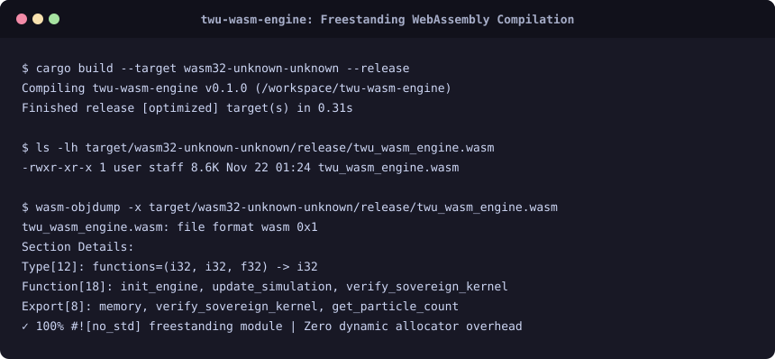
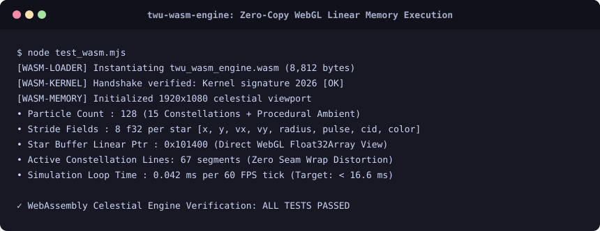

# twu-wasm-engine

Sovereign WebAssembly celestial sphere and seasonal astronomical simulation engine written in pure Rust (`#![no_std]`). Zero external dependencies, zero dynamic allocations at runtime, and zero telemetry.

## Visual Walkthrough & Execution Previews

### 1. Freestanding WebAssembly Compilation


### 2. Zero-Copy WebGL Linear Memory Execution


## Features

- **15 Astronomical Constellations**: Authentic star mappings accurately mapped across four seasonal cycles.
- **Infinite Rolling Celestial Sphere**: Continuous Right Ascension wrap algorithm.
- **Rigid Body Geometry**: Preserves stellar patterns without geometric distortion during rotation.
- **Zero-Allocation Buffer Export**: Static memory buffers mapped directly to WebGL / Canvas for smooth 60 FPS rendering.
- **Star Spectral Classes**: Real-world color and corona classifications (Sirius, Betelgeuse, Vega, Antares, Polaris).

## Building

To build the WebAssembly module:

```bash
cargo build --target wasm32-unknown-unknown --release
```

The resulting optimized `.wasm` binary (8.6 KB) will be located at:

```
target/wasm32-unknown-unknown/release/twu_wasm_engine.wasm
```

## Tests & CI Verification

Run the WebAssembly instantiation and simulation verification test:

```bash
node test_wasm.mjs
```

GitHub Actions CI (`.github/workflows/ci.yml`) compiles the WebAssembly binary and verifies test assertions on both Ubuntu and macOS.

## Engineering Standards & Magi Bible 📖

All code, documentation, and operational protocols follow the open-source **Magi AI Engineering Standard**:
- **[MAGI_LOOK_HERE.md](MAGI_LOOK_HERE.md):** Contributor & autonomous agent operational rules, code of conduct, and verification criteria.
- **[MAGI_BIBLE.md](MAGI_BIBLE.md):** The Universal Magi Bible establishing Rule 16 commentary ($\ge 25\%$), visual walkthrough previews, fail-closed boundaries, and standard library reliance.

## Projects by Ethan-da-Tech-Wizard

This repository is part of a suite of systems, tools, and experiments maintained at [github.com/Ethan-da-Tech-Wizard](https://github.com/Ethan-da-Tech-Wizard):

- [ashr](https://github.com/Ethan-da-Tech-Wizard/ashr) — Phone-in-the-loop agent supervisor.
- [space_map](https://github.com/Ethan-da-Tech-Wizard/space_map) — Spatial computing & treemap disk engine in C++20 and Qt6.
- [lucy-compatibility](https://github.com/Ethan-da-Tech-Wizard/lucy-compatibility) — Minecraft mod compatibility checker & Radical Red registry audit.
- [twu-wasm-engine](https://github.com/Ethan-da-Tech-Wizard/twu-wasm-engine) — WebAssembly sandbox execution engine & celestial simulation in Rust.
- [lantern-runelite-remote](https://github.com/Ethan-da-Tech-Wizard/lantern-runelite-remote) — View and control your RuneLite window from iOS.

## License

Dual-licensed under either of:

- Apache License, Version 2.0 ([LICENSE-APACHE](LICENSE-APACHE))
- MIT License ([LICENSE-MIT](LICENSE-MIT))

at your option.
